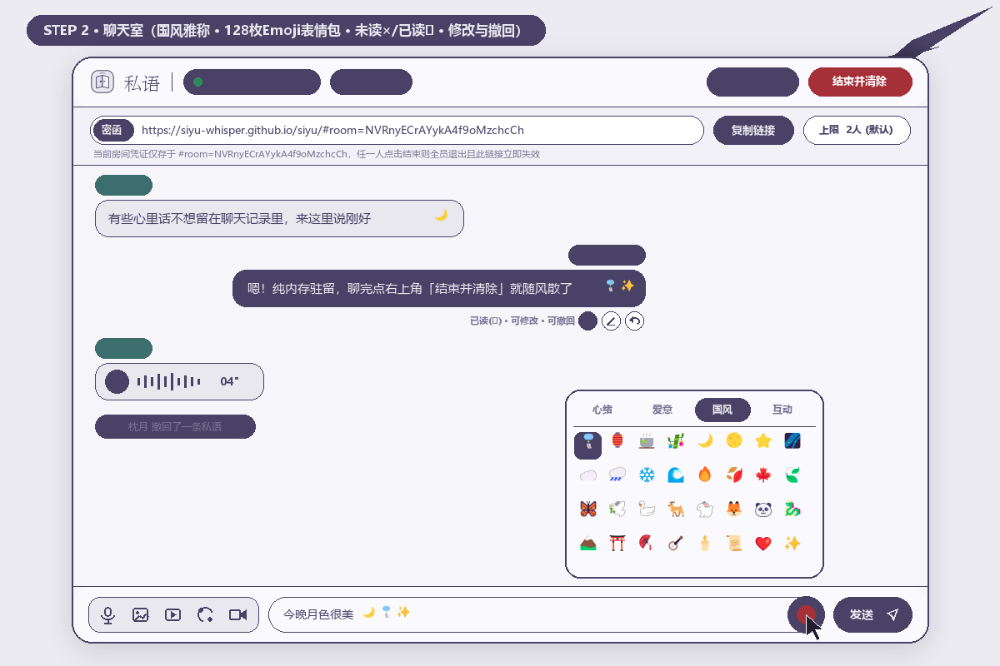
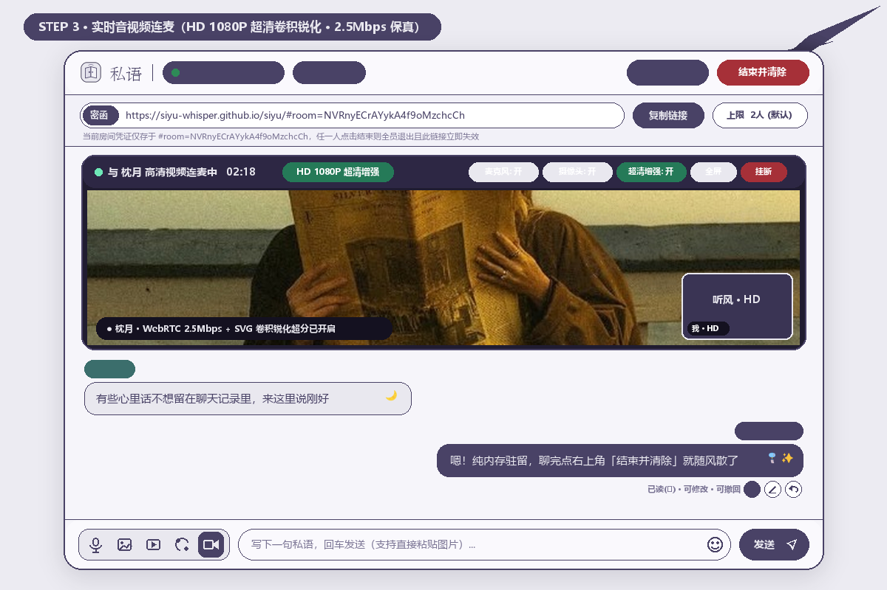
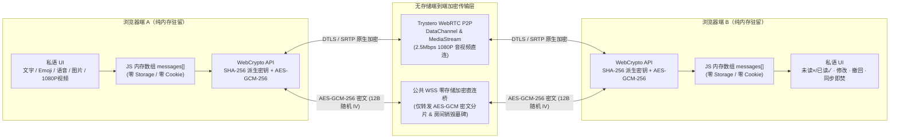

<div align="center">


# 私语 (Siyu)

**“有些话不必惊动世界，读完便融进风里。”**

极简 · 免安装 · 免注册 · 零服务器存储 · 点对点端到端加密 · 阅后即焚临时私密聊天空间

[](https://siyu-whisper.github.io/siyu/)
[](./LICENSE)
[](#五技术架构与安全原理)
[](#五技术架构与安全原理)

</div>

---

## 一、为什么要做「私语」？（它的目的与初衷）

在日常使用的即时通讯软件里，你随口说出的一句倾诉、一张随手拍下的照片、一段深夜的语音，都会被永久同步到云端服务器、写入本地数据库、纳入全文搜索索引，成为永远无法真正抹去的“数字遗产”。

然而在很多真实时刻，我们只需要一个**当下说完、读完即散**的安静角落：

- 🌙 **恋人或挚友的深夜树洞**：有些脆弱、心事或悄悄话，只想在那一刻说给懂的人听，不想留在任何人的漫长聊天记录里被日后翻阅。
- 🔐 **临时敏感信息传递**：临时核对一段口令、配置或私密照片，传完即焚，拒绝在社交软件云端永久留档。
- 🍃 **无社交压力的纯粹对谈**：不想下载几十兆的 App、不想绑定手机号注册账号、不想授权通讯录与定位画像——**点开网页即建房间，发一条密函链接给对方，聊完一键清空，一切随风散去。**

**「私语」(Siyu)** 正是为此而生的开源极简网页工具：**没有后端数据库、没有账号体系、没有任何追踪埋点**，消息只驻留在双方当前打开的浏览器内存中；只要任意一人点击「结束并清除」，全员画面同步清空，原分享链接永久作废。

---

## 二、10 秒看懂「私语」全流程（动态演示）

<div align="center">
  
  <p><em>▲ 从「画廊首页一键建房」→「复制密函链接配对」→「文字/Emoji/语音/图片私密收发」→「HD 1080P 超清视频连麦」→「一键全员焚毁且原链接永久失效」</em></p>
</div>

---

## 三、四步核心界面实景导览

### Step 1 · 极简美术馆相框首页（免注册 · 免安装 · 点开即用）

采用中国传统色对撞美学——**暮山黛紫（`#494266`）× 云水灰白（`#E9E8EF`）**，以美术馆双层衬纸相框装裱画芯。无需登录账号，点击底部 **「点击我，开始私语吧」** 即可在本地瞬间生成 24 位高熵加密房间。

<div align="center">
  
</div>

### Step 2 · 纯内存私密聊天室（国风雅称 · 128 枚 Emoji 表情包 · 未读 `×` / 已读 `✓` · 修改与撤回）

- **自动国风雅称印章**：进入房间自动分配 **「听风」「枕月」「观云」「拾叶」「眠雪」** 等莫兰迪色印章代号（点击顶部印章可随时自定义改名），默认 **2 人**私密对谈，最高支持调节至 **5 人**密友小聚。
- **内置 4 大分类 128 枚 Emoji 表情包**：输入框右侧内嵌微笑表情按钮，包含 **「心绪」「爱意」「国风」「互动」** 四栏精选 Emoji，支持光标处混排插入。
- **精细到每一条私语的掌控权**：自己发出的消息底部实时显示 **未读 (`×`) / 已读 (`✓`)** 状态；发出的文字支持点击 **笔形图标 (`✎`) 在线修改并同步刷新对方屏幕**；所有消息（文字/图片/语音/视频）均支持点击 **撤回图标 (`↺`) 一键撤回**。

<div align="center">
  
</div>

### Step 3 · 实时语音通话 & HD 1080P 超清视频连麦（硬件级卷积锐化增强）

砍掉冗余繁杂的桌面共享功能，只保留最纯粹的 **语音、视频、文字、图片** 四大媒介，并专门针对视频画质内置了 **HD 1080P 超清处理引擎**：

- **1080P / 720P 细节优先采集**：默认请求 `1920×1080 @ 30~60fps` 高清视频流，并标记 `videoTrack.contentHint = 'detail'` 指示编码器优先保留纹理细节。
- **WebRTC 2.5 Mbps 高码率与保分辨率传输**：底层自动将 `RTCRtpSender` 最大码率提升至 `2.5 Mbps`，并设置 `degradationPreference = 'maintain-resolution'`，拒绝弱网自动糊化。
- **SVG 硬件卷积锐化与色彩超分滤镜**：内置 `#siyu-hd-sharpen`（`feConvolveMatrix` 3×3 非锐化掩模核 + 线性对比度提升），通话顶栏支持随时点击 **「✨ 超清增强: 开/关」** 实时切换对比。

<div align="center">
  
</div>

### Step 4 · 真正的阅后即焚（全员同步清空 · 原密函链接永久作废拦截）

- **一人点击，全员即焚**：房间内任意一人点击右上角红色 **「结束并清除」**，所有在线成员的浏览器内存数组立即清零，并同步跳转至终态画框页——**“话已燃尽，一切随风去吧。”**
- **加密墓碑防重入**：房间销毁瞬间会自动写入一枚不含任何聊天内容的 AES-GCM 加密销毁墓碑；此后任何人再次点击原来的 `#room=` 旧链接，都会被立即拦截在 **「连接已失效」** 页面，彻底杜绝事后翻查。

<div align="center">
  
</div>

---

## 四、核心特性一览

| 维度 | 「私语」(Siyu) 的设计实现 |
| --- | --- |
| **轻巧免安装** | 纯静态 Web 应用，零后端依赖，点开即用，无需下载安装任何 App 或插件 |
| **快捷零门槛** | 免注册、免登录、不绑手机号；复制一条 `#room=` 密函链接发给对方即可秒连 |
| **私密端到端加密** | WebRTC `SCTP DataChannel`（DTLS 原生加密）+ WebCrypto `AES-GCM-256` 端到端加密双通道 |
| **纯粹无追踪** | 零 `localStorage`、零 `sessionStorage`、零 `IndexedDB`、零 `Cookie`、零第三方统计分析脚本 |
| **四大纯粹媒介 + 表情包** | 专注 **文字**（含 128 枚四栏 Emoji 表情包）、**加密图片**（支持粘贴/拖拽/灯箱预览）、**语音**（语音短讯 + 实时语音通话）、**高清视频**（短视频气泡 + 1080P 实时视频连麦） |
| **状态与撤回编辑** | 未读显示 `×`、对方查看即变 `✓`；文字消息可随时在线修改重刷；全部消息均可实时撤回 |
| **人数上限门禁** | 默认 **2 人**二人世界，房主可在顶栏随时调整上限（最高 **5 人**），超员自动拦截提示「无法加入私语」 |
| **阅后即焚与链接作废** | 关闭页面或点击「结束并清除」，全员内存清零退出，原房间密函链接永久失效 |

---

## 五、技术架构与安全原理



1. **URL `#` 片段（Hash Fragment）密钥隔离**：
   房间凭证存放在 `#room=<24位高熵随机ID>` 中。根据浏览器 RFC 规范，URL `#` 号后面的内容**永远不会在 HTTP 请求中发送给托管静态网页的服务器**（如 GitHub Pages），并由客户端通过 `crypto.subtle.digest('SHA-256')` 在本地派生出 `AES-GCM-256` 对称密钥。
2. **双引擎连接保障（WebRTC P2P + AES-GCM 零存储直连）**：
   优先通过 WebRTC 建立点对点原生音视频与数据通道；当跨运营商对称型 NAT 防火墙阻断 UDP 打洞时，自动无缝启用 `AES-GCM-256`（每帧独立 12 字节随机 IV）加密分片通道，确保不同网络下的手机与电脑也能 100% 秒连互通，且中继节点无法解密任何一字节内容。

---

## 六、目录结构与本地运行

```text
siyu/
├── index.html                   # 页面入口（画廊相框首页、聊天室视图、终态销毁视图）
├── main.js                      # 核心 P2P 加密通信、Emoji 表情包、HD 1080P 视频增强与双向即焚逻辑
├── style.css                    # 中国传统色对撞（#494266 × #E9E8EF）与画廊相框响应式样式
├── logo.svg                     # 私语专属 L1 极简折页耳语矢量图标
├── hero-couple.jpg              # 首页中央相框画芯（长椅旧报私语）
├── end-burn.jpg                 # 终态页中央相框画芯（话已燃尽，一切随风去吧）
├── vendor/
│   └── trystero-nostr.js        # 免构建直开兼容模块（支持静态服务器零构建直接运行）
├── docs/
│   └── screenshots/             # README 动态演示 GIF 与四步高清实景图
├── xiaohongshu-pack/            # 小红书小工具容器离线包（符合 minitool-zip-builder 规范）
├── package.json                 # 项目配置与构建脚本（MIT License）
├── vite.config.js               # Vite 打包配置
└── .github/workflows/deploy.yml # GitHub Actions 自动部署至 GitHub Pages
```

### 本地启动与构建

- **方式一：零构建直接运行（推荐快速预览）**
  本项目已内置 Import Map 与 `vendor/` 模块，任意静态 HTTP 服务器（如 `npx serve .` 或 `python -m http.server 8080`）打开根目录即可直接运行。
- **方式二：使用 Vite 开发与生产构建**
  ```bash
  npm install
  npm run dev      # 启动本地开发热更新服务
  npm run build    # 构建生产静态产物至 dist/
  ```

---

## 七、开源协议与致谢

- 本项目基于 **[MIT License](./LICENSE)** 开源，欢迎任何人自由 Fork、审计代码或部署属于自己的私语空间。
- WebRTC P2P 信令抽象受 [Trystero](https://github.com/dmotz/trystero) 与 [Chitchatter](https://github.com/jeremyckahn/chitchatter) 启发，全部源码、高清视频滤镜管线与东方画廊视觉规范均为独立原创实现。

