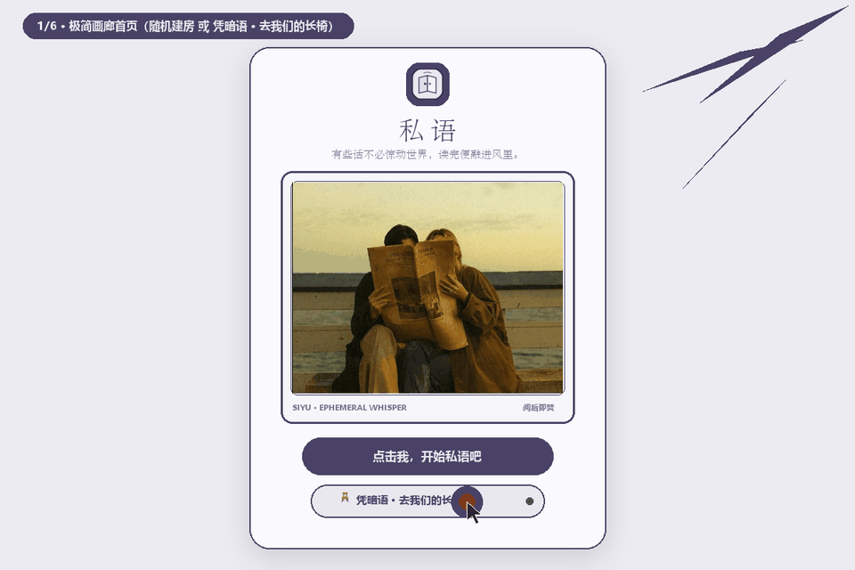
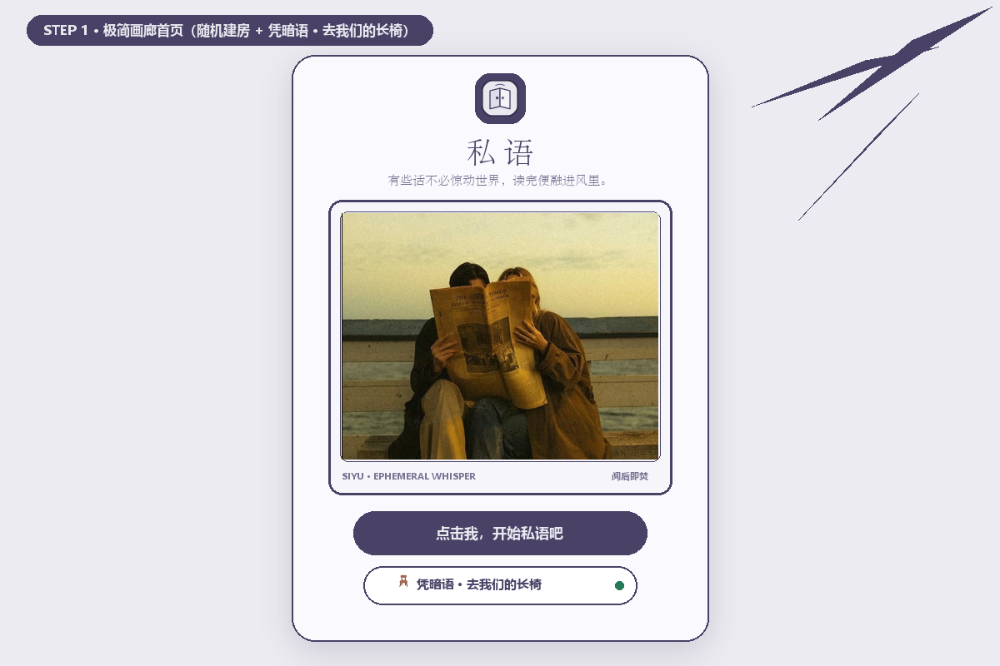
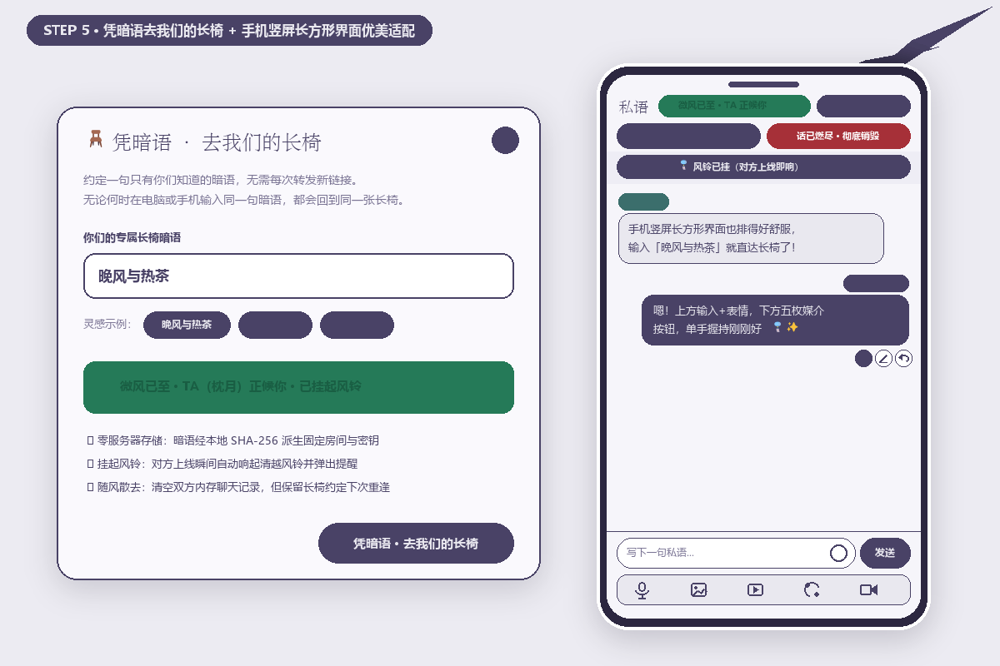
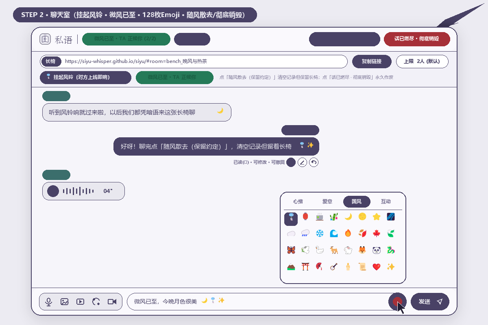
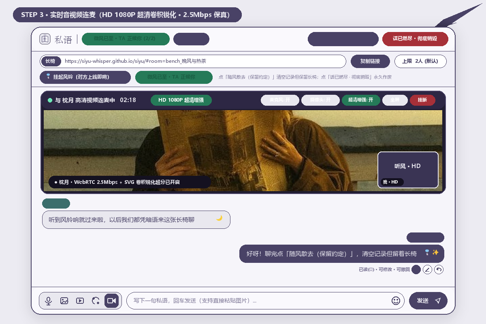
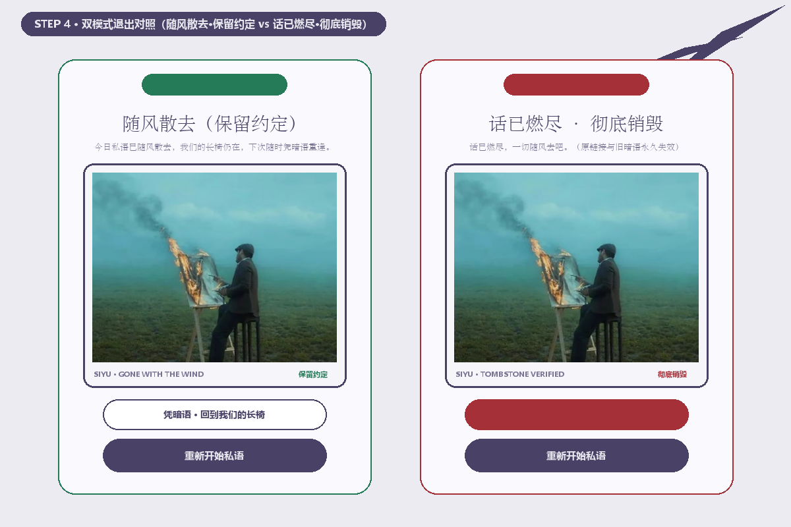
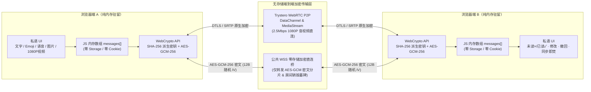
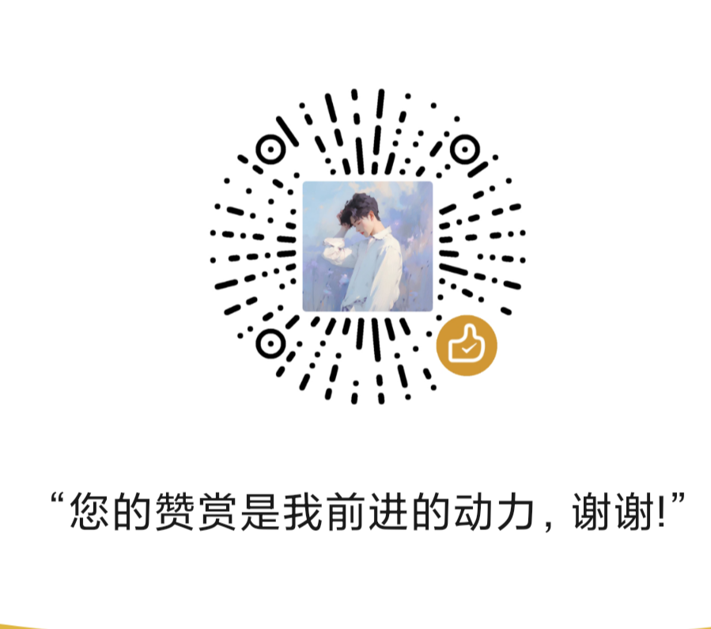

<div align="center">


# 私语 (Siyu)

**“有些话不必惊动世界，读完便融进风里。”**

极简 · 免安装 · 免注册 · 零服务器存储 · 点对点端到端加密 · 阅后即焚临时私密聊天空间

[](https://siyu-whisper.github.io/siyu/)
[](./LICENSE)
[](#五技术架构与安全原理)
[](#五技术架构与安全原理)

</div>

---

## 一、为什么要做「私语」？（它的目的与初衷）

在日常使用的即时通讯软件里，你随口说出的一句倾诉、一张随手拍下的照片、一段深夜的语音，都会被永久同步到云端服务器、写入本地数据库、纳入全文搜索索引，成为永远无法真正抹去的“数字遗产”。

然而在很多真实时刻，我们只需要一个**当下说完、读完即散**的安静角落：

- 🌙 **恋人或挚友的深夜树洞**：有些脆弱、心事或悄悄话，只想在那一刻说给懂的人听，不想留在任何人的漫长聊天记录里被日后翻阅。
- 🔐 **临时敏感信息传递**：临时核对一段口令、配置或私密照片，传完即焚，拒绝在社交软件云端永久留档。
- 🍃 **无社交压力的纯粹对谈**：不想下载几十兆的 App、不想绑定手机号注册账号、不想授权通讯录与定位画像——**点开网页即建房间，发一条密函链接给对方，聊完一键清空，一切随风散去。**

**「私语」(Siyu)** 正是为此而生的开源极简网页工具：**没有后端数据库、没有账号体系、没有任何追踪埋点**，消息只驻留在双方当前打开的浏览器内存中；只要任意一人点击「结束并清除」，全员画面同步清空，原分享链接永久作废。

---

## 二、10 秒看懂「私语」全流程（动态演示）

<div align="center">
  
  <p><em>▲ 从「画廊首页随机建房 / 🪑 凭暗语 · 去我们的长椅」→「🎐 挂起风铃（对方上线即响）与微风已至实时感知」→「文字 / 128枚Emoji / 语音 / 图片私密收发」→「HD 1080P 超清视频连麦」→「随风散去（保留约定）或 话已燃尽 · 彻底销毁」</em></p>
</div>

---

## 三、核心界面与全新「专属长椅 · 风铃守候」使用方法

### Step 1 · 极简美术馆相框首页（随机建房 + `🪑 凭暗语 · 去我们的长椅`）

采用中国传统色对撞美学——**暮山黛紫（`#494266`）× 云水灰白（`#E9E8EF`）**，以美术馆双层衬纸相框装裱画芯。首页提供两种进入方式：
1. **「点击我，开始私语吧」**：在本地瞬间生成 24 位高熵一次性加密房间。
2. **「🪑 凭暗语 · 去我们的长椅」**：专为经常聊天的伴侣或挚友设计——两人只需约定一句只有彼此知道的暗语（如 `晚风与热茶`），无需每次转发新链接，随时随地输入同一句暗语即可回到同一张固定长椅。

<div align="center">
  
</div>

### Step 2 · 专属长椅暗语入场 & 手机竖屏长方形界面优美适配

- **不借道微信/短信，如何知道对方到了长椅？**
  - **进入前实时感知（`微风已至 · TA 正候你`）**：在首页点击 **「🪑 凭暗语 · 去我们的长椅」** 输入暗语时，前端会自动通过本地派生的 `AES-GCM-256` 密钥探测长椅状态。若对方已在长椅中或已挂起风铃，弹窗内会立即点亮翠绿呼吸灯提示：**`🎐 微风已至 · TA 正候你`**。
  - **进入后守候提醒（`🎐 挂起风铃（对方上线即响）`）**：若你先一步来到长椅，只需点击顶栏下方的 **「🎐 挂起风铃（对方上线即响）」**。此后哪怕你将网页切到后台或最小化，一旦对方凭暗语踏入长椅，浏览器会**立即响起清越的东方风铃泛音**、闪烁标签页标题并弹出系统通知提醒你 **「微风已至 · TA 正候你」**。
- **电脑端与手机竖屏长方形界面双栖优美适配**：
  - 针对手机端竖屏长方形屏幕（`100dvh` + 安全区 `safe-area-inset`）进行了专门的人体工学排版：顶栏采用对称双排胶囊布局，底部采用「上排输入框+内嵌表情+发送、下排五枚媒介按钮均匀分布」的双层悬浮坞，单手握持舒适优雅。

<div align="center">
  
</div>

### Step 3 · 纯内存私密聊天室（国风雅称 · 128 枚 Emoji 表情包 · 未读 `×` / 已读 `✓` · 修改与撤回）

- **自动国风雅称印章**：进入房间自动分配 **「听风」「枕月」「观云」「拾叶」「眠雪」** 等莫兰迪色印章代号（点击顶部印章可随时自定义改名），默认 **2 人**私密对谈，最高支持调节至 **5 人**密友小聚。
- **内置 4 大分类 128 枚 Emoji 表情包**：输入框右侧内嵌微笑表情按钮，包含 **「心绪」「爱意」「国风」「互动」** 四栏精选 Emoji，支持光标处混排插入。
- **精细到每一条私语的掌控权**：自己发出的消息底部实时显示 **未读 (`×`) / 已读 (`✓`)** 状态；发出的文字支持点击 **笔形图标 (`✎`) 在线修改并同步刷新对方屏幕**；所有消息（文字/图片/语音/视频）均支持点击 **撤回图标 (`↺`) 一键撤回**。

<div align="center">
  
</div>

### Step 4 · 实时语音通话 & HD 1080P 超清视频连麦（硬件级卷积锐化增强）

专注最纯粹的 **语音、视频、文字、图片** 四大媒介，并专门针对视频画质内置了 **HD 1080P 超清处理引擎**：

- **1080P / 720P 细节优先采集**：默认请求 `1920×1080 @ 30~60fps` 高清视频流，并标记 `videoTrack.contentHint = 'detail'` 指示编码器优先保留纹理细节。
- **WebRTC 2.5 Mbps 高码率与保分辨率传输**：底层自动将 `RTCRtpSender` 最大码率提升至 `2.5 Mbps`，并设置 `degradationPreference = 'maintain-resolution'`，拒绝弱网自动糊化。
- **SVG 硬件卷积锐化与色彩超分滤镜**：内置 `#siyu-hd-sharpen`（`feConvolveMatrix` 3×3 非锐化掩模核 + 线性对比度提升），通话顶栏支持随时点击 **「✨ 超清增强: 开/关」** 实时切换对比。

<div align="center">
  
</div>

### Step 5 · 双模式退出：`🍃 随风散去（保留约定）` vs `🔥 话已燃尽 · 彻底销毁`

为了兼顾「固定长椅常聊」与「一次性彻底销毁」两种场景，聊天室顶栏右上角提供两种清晰的告别方式：

1. **`🍃 随风散去（保留约定）`**：
   - 适合固定长椅日常聊完离开：点击后**所有在线成员的浏览器内存聊天记录立即同步清零**并回到结束页，但**保留长椅暗语与房间链接不作废**；下次两人仍可凭同一句暗语回到这张长椅重逢。
2. **`🔥 话已燃尽 · 彻底销毁`**：
   - 适合彻底封存销毁：点击后全员内存清零，同时写入一枚 AES-GCM 加密销毁墓碑（**“话已燃尽，一切随风去吧。”**）；此后任何人再次点击原链接或输入旧暗语，都会被立即拦截在 **「连接已失效」** 页面。

<div align="center">
  
</div>

---

## 四、核心特性一览

| 维度 | 「私语」(Siyu) 的设计实现 |
| --- | --- |
| **轻巧免安装** | 纯静态 Web 应用，零后端依赖，点开即用，无需下载安装任何 App 或插件 |
| **快捷零门槛** | 免注册、免登录、不绑手机号；复制一条 `#room=` 密函链接发给对方即可秒连 |
| **私密端到端加密** | WebRTC `SCTP DataChannel`（DTLS 原生加密）+ WebCrypto `AES-GCM-256` 端到端加密双通道 |
| **纯粹无追踪** | 零 `localStorage`、零 `sessionStorage`、零 `IndexedDB`、零 `Cookie`、零第三方统计分析脚本 |
| **四大纯粹媒介 + 表情包** | 专注 **文字**（含 128 枚四栏 Emoji 表情包）、**加密图片**（支持粘贴/拖拽/灯箱预览）、**语音**（语音短讯 + 实时语音通话）、**高清视频**（短视频气泡 + 1080P 实时视频连麦） |
| **状态与撤回编辑** | 未读显示 `×`、对方查看即变 `✓`；文字消息可随时在线修改重刷；全部消息均可实时撤回 |
| **固定长椅与风铃守候** | 支持 **「🪑 凭暗语 · 去我们的长椅」**（SHA-256 派生固定房间）与 **「🎐 挂起风铃（对方上线即响）」**，对方到达即刻显示 **「微风已至 · TA 正候你」** 并响起风铃提醒 |
| **双模式告别机制** | 支持 **「🍃 随风散去（保留约定）」**（仅清空内存记录，保留长椅暗语）与 **「🔥 话已燃尽 · 彻底销毁」**（清空内存并永久作废原房间） |
| **电脑与手机竖屏双栖适配** | 桌面端画廊卡片 + 手机端竖屏长方形（`100dvh` + 安全区）自适应人体工学双层输入坞 |
| **人数上限门禁** | 默认 **2 人**二人世界，房主可在顶栏随时调整上限（最高 **5 人**），超员自动拦截提示「无法加入私语」 |
| **阅后即焚与链接作废** | 关闭页面或点击「话已燃尽 · 彻底销毁」，全员内存清零退出，原房间密函链接永久失效 |

---

## 五、技术架构与安全原理



1. **URL `#` 片段（Hash Fragment）密钥隔离**：
   房间凭证存放在 `#room=<24位高熵随机ID>` 中。根据浏览器 RFC 规范，URL `#` 号后面的内容**永远不会在 HTTP 请求中发送给托管静态网页的服务器**（如 GitHub Pages），并由客户端通过 `crypto.subtle.digest('SHA-256')` 在本地派生出 `AES-GCM-256` 对称密钥。
2. **双引擎连接保障（WebRTC P2P + AES-GCM 零存储直连）**：
   优先通过 WebRTC 建立点对点原生音视频与数据通道；当跨运营商对称型 NAT 防火墙阻断 UDP 打洞时，自动无缝启用 `AES-GCM-256`（每帧独立 12 字节随机 IV）加密分片通道，确保不同网络下的手机与电脑也能 100% 秒连互通，且中继节点无法解密任何一字节内容。

---

## 六、目录结构与本地运行

```text
siyu/
├── index.html                   # 页面入口（画廊相框首页、聊天室视图、终态销毁视图）
├── main.js                      # 核心 P2P 加密通信、Emoji 表情包、HD 1080P 视频增强与双向即焚逻辑
├── style.css                    # 中国传统色对撞（#494266 × #E9E8EF）与画廊相框响应式样式
├── logo.svg                     # 私语专属 L1 极简折页耳语矢量图标
├── hero-couple.jpg              # 首页中央相框画芯（长椅旧报私语）
├── end-burn.jpg                 # 终态页中央相框画芯（话已燃尽，一切随风去吧）
├── vendor/
│   └── trystero-nostr.js        # 免构建直开兼容模块（支持静态服务器零构建直接运行）
├── docs/
│   └── screenshots/             # README 动态演示 GIF 与四步高清实景图
├── xiaohongshu-pack/            # 小红书小工具容器离线包（符合 minitool-zip-builder 规范）
├── package.json                 # 项目配置与构建脚本（MIT License）
├── vite.config.js               # Vite 打包配置
└── .github/workflows/deploy.yml # GitHub Actions 自动部署至 GitHub Pages
```

### 本地启动与构建

- **方式一：零构建直接运行（推荐快速预览）**
  本项目已内置 Import Map 与 `vendor/` 模块，任意静态 HTTP 服务器（如 `npx serve .` 或 `python -m http.server 8080`）打开根目录即可直接运行。
- **方式二：使用 Vite 开发与生产构建**
  ```bash
  npm install
  npm run dev      # 启动本地开发热更新服务
  npm run build    # 构建生产静态产物至 dist/
  ```

---

## 七、赞赏与支持（Appreciate & Sponsor）

如果「私语」(Siyu) 为你和重要的人提供了一方安静、纯粹、无痕的倾诉角落，欢迎扫码赞赏支持作者继续打磨更多克制而温暖的独立作品：

<div align="center">
  
  <p><strong>“您的赞赏是我前进的动力，谢谢！”</strong></p>
</div>

---

## 八、开源协议与致谢

- 本项目基于 **[MIT License](./LICENSE)** 开源，欢迎任何人自由 Fork、审计代码或部署属于自己的私语空间。
- WebRTC P2P 信令抽象受 [Trystero](https://github.com/dmotz/trystero) 与 [Chitchatter](https://github.com/jeremyckahn/chitchatter) 启发，全部源码、高清视频滤镜管线与东方画廊视觉规范均为独立原创实现。

